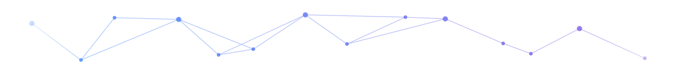

### 윤효연 · Hyoyeon Yoon

세종대학교 컴퓨터공학과 · 2027.02 졸업예정

 

<b>사용자의 불편</b>과 <b>팀의 병목</b>을 찾아 개선하는 프론트엔드 개발자입니다. 
문제를 먼저 이해하고, 상황에 맞는 기술로 해결하는 과정을 좋아합니다.

 

## Experience

<table>
<tr><td>

#### `AiderX` &nbsp;·&nbsp; Software Engineer Intern (Frontend)

`2026.01 – 2026.02` · 리테일 미디어 광고 운영·분석 플랫폼

광고 플랫폼(Flutter Web) · 랜딩 블로그(Next.js) 개발 · 머지 PR 22건

- **성능** — 블로그 조회 지연 개선: 목록/상세 API 분리 · 서버 필터링 → 응답 **1,645 → 1,099ms**, 페이로드 **49.9 → 3.8KB**
- **분석** — 캠페인 유형 6종 집행률 산식 정의, 진척도 시각화
- **권한** — 광고주 · 리테일러 · 어드민 계정별 조회/편집 화면 분리
- **CI** — 모델 테스트가 실행되지 않던 CI 설정 오류 발견 · 수정

     

</td></tr>
</table>

 

## Projects

<table>
<tr><td>

#### [`ONFLEA`](https://github.com/onflea) &nbsp;·&nbsp; 크리에이터 의류 리커머스 &nbsp;

2인 팀, 개발 전담

**성과** — 영업 메일 건당 발송 시간 **46.6초 → 3.7초** (같은 날 수동 발송 대비, Gmail 발송 기록 기준 · 발굴 · 분석 시간 제외) · 도구로 보낸 제안 메일 → 매니지먼트사 회신 → 소속 크리에이터 2명 위탁판매 계약

**1. [서비스 랜딩페이지](https://github.com/onflea/onflea-landing)** · [corp.onflea.kr](https://corp.onflea.kr)

- **소식** — 노션을 CMS로 쓰는 소식 페이지 (목록 · 상세 · 블록 렌더링 · 조회수 기록)
- **캐시 갱신** — 노션에서 글을 발행 · 수정하면 웹훅(서명 검증)으로 소식 캐시 즉시 갱신
- **이미지** — 노션 이미지의 임시 주소가 만료돼 깨지던 문제를 고정 주소 + CDN 캐싱으로 해결
- **SEO** — 메타데이터 · OG 이미지 · 사이트맵 · 구조화 데이터(JSON-LD), 네이버 사이트 등록

**2. 영업 자동화 도구** `private` · 채널 분석 → 후보 발굴 → 제안 메일 발송 → 열람 추적

- **분석** — YouTube Data API 기반 채널 지표 · 댓글 수집, 자체 선별 기준 6개 축 100점 스코어링
- **발굴** — 후보 채널 병렬 분석, Claude API로 무관 채널 필터링
- **발송** — 공개 연락처 정규식 추출 → Claude로 운영자 본인 주소 판별 → 발송
- **추적** — 메일 열람 · 클릭 추적, 발신자 본인 열람 제외용 Chrome 확장 개발

**3. 자체 쇼핑몰** `private` · 미출시

- **재고 선점** — 1점뿐인 상품에 동시 구매가 몰려도 DB 행 잠금으로 한 명만 선점, 7분 뒤 자동 만료
- **카운트다운** — 서버 시각 기준으로 선점 남은 시간 계산, 기기 시계 오차 보정
- **목록 · 검색** — 서버 필터링 · 페이지네이션, 검색 디바운스 · 늦게 도착한 이전 결과 무시

        

</td></tr>
</table>

<table>
<tr><td>

#### [`XROSS`](https://github.com/SEJONG-XROSS/xross-frontend) &nbsp;·&nbsp; 무인점포 절도 탐지 · 통합 관제 플랫폼

프론트엔드 단독 (웹 + 모바일) · 🏆 대상 3회 · [Landing](https://xross-landing.vercel.app)

비전 AI · 무게센서 · POS 데이터 교차검증 캡스톤 프로젝트, 관제 웹 · 점주용 앱 개발

- **웹** — 관제 대시보드 개발 (실시간 모니터링 · 이벤트 상세 · POS 매출 조회)
- **모바일** — 웹 · 앱 공통 로직 분리와 모노레포(pnpm + Turborepo) 전환, 점주 앱 개발
- **공유 설계** — 도메인 로직 `@xross/core` 분리, 플랫폼별 SSE 구현 주입으로 웹 · 앱 훅 통합
- **영상** — react-native-webrtc 기반 모바일 WHEP 재생 클라이언트 구현
- **랜딩** — 서비스 소개 랜딩페이지 개발, 문의 폼 내용을 Google Sheets에 자동 기록

        

</td></tr>
</table>

<table>
<tr><td>

#### [`DOORI`](https://github.com/TEAM-DOORI/doori-frontend) &nbsp;·&nbsp; 룸메이트 매칭 앱

6인 팀 (기획 1 · 디자인 1 · FE 2 · BE 2), 프론트엔드

비개발 직군 팀원이 일일이 물어보거나 GitHub에 들어가지 않아도 개발 진행 상황을 노션에서 확인하도록 협업 자동화

- **노션 연동** — 이슈 생성 시 노션 작업 카드 자동 생성, PR · 이슈 상태에 따라 카드 상태 자동 갱신 (시작전 → 리뷰중 → 완료) · GitHub Actions 워크플로 3종 단독 작성
- **협업 흐름** — CONTRIBUTING.md로 이슈 → 브랜치 → PR → CI → 리뷰 → 머지 규칙 문서화
- **CI** — ESLint → 타입 검사 → Jest 3단계 CI 구성, Node · 패키지 매니저 버전 고정
- **화면** — 홈 · 채팅(목록/채팅방) 개발, 팀원 화면 코드리뷰

    

</td></tr>
</table>

<table>
<tr><td>

#### [`meeTeam`](https://github.com/WardK-meeTeam/meeteam_front) &nbsp;·&nbsp; 사이드 프로젝트 팀 매칭 플랫폼

프론트엔드 4인 · 세종대 중앙동아리 ALOM

- **인증** — 로그인 인증 흐름 담당: 만료 전 토큰 선제 갱신, 서버 · 클라이언트 환경을 구분한 토큰 재발급 · 재요청 처리
- **목록** — 필터 · 정렬 쿼리스트링 동기화, 무한 스크롤 구현

  

</td></tr>
</table>

<table>
<tr><td>

#### [`Ditto`](https://github.com/yoonhyoyeon/ditto_frontend) · [`ON:ER`](https://github.com/yoonhyoyeon/oner-frontend) &nbsp;·&nbsp; 실시간 영상 기반 부정행위 · 부정출결 감지

프론트엔드 단독 · 🏆 해커톤 대상 · 금상

실시간 영상 전송 — 앞 프로젝트에서 드러난 한계를 다음 프로젝트에서 개선

- **2024 Ditto** — 웹캠 프레임 JPEG 0.2초 간격 Socket.IO 전송, 서버 분석 결과 실시간 표시 → 전송 지연 한계
- **2025 ON:ER** — 지연을 줄이려 WebRTC P2P(풀 메시)로 개선, 시그널링 직접 구현 → 다자 연결 불안정 원인 분석(TURN 부재 · glare · ICE 후보 유실)
- **2026 XROSS** — 다자 연결 한계를 넘는 미디어 서버 경유 구조에서 WHEP 재생 클라이언트 구현 (위 카드)

     

</td></tr>
</table>

<table>
<tr><td>

#### [`CIFFY`](https://github.com/yoonhyoyeon/ciffy-ai-frontend) &nbsp;·&nbsp; 시간표 추천 · 졸업요건 관리

프론트엔드 단독 · 🏆 학술제 대상 2관왕 · [Live](https://ciffy-ai-frontend.vercel.app)

1차 버전([ciffy-timetable-creater](https://github.com/yoonhyoyeon/ciffy-timetable-creater))을 Next.js App Router로 재구현

- **서버 액션** — Server Actions로 로그인 · 후기 등록 처리
- **라우팅** — 인터셉팅 라우트 모달(로그인 · 성적 업로드), 시간표 설문 중 이탈 방지(next-navigation-guard)
- **데이터** — API 응답 → 화면 모델 변환 어댑터 계층 구현

   

</td></tr>
</table>

<table>
<tr><td>

#### [`Dappy`](https://github.com/yoonhyoyeon/dappy-sw-ai-hack) &nbsp;·&nbsp; 구역별 재난 감지 · 3D 대피 경로 안내

2인 팀, 프론트엔드 · 🏆 해커톤 대상 · [Live](https://dappy-sw-ai-hack.vercel.app)

- **3D** — Three.js 3D 도면 빌더 · 대피 경로 렌더링 및 애니메이션 구현 (경로 계산은 AI 서버)
- **논문** — 확장 내용 [CVM 2026 Technical Brief](https://iccvm.org/2026/program.htm) 채택 (T15, 제2저자)

     

</td></tr>
</table>

&nbsp;<b>그 외</b>

 

- [`Proofolio`](https://github.com/yoonhyoyeon/proofolio-frontend) — GitHub 기반 포트폴리오 생성 · AI 면접 (해커톤 장려상, 3인 팀) · GitHub OAuth · 포트폴리오 빌더 개발
- [`Parallel Diary`](https://github.com/yoonhyoyeon/parallel-diary-frontend) — 일기 · 분석 PWA (React 19, TanStack Router)
- [`CryptoGame`](https://github.com/yoonhyoyeon/crypto-game) — 동아리 부스용 게임, Canvas API로 캔들차트 직접 렌더링
- [`DevTalk`](https://github.com/yoonhyoyeon/devtalk-backend) — 개발자 커뮤니티 REST API (Express 5, TypeScript, Mongoose, JWT, zod)
- [`채팅앱`](https://github.com/yoonhyoyeon/hyoyeon-chatapp) · [`Modern`](https://github.com/yoonhyoyeon/Modern) — 고교 시절 jQuery + Firebase 실시간 채팅(2018) · Ghost 블로그 테마(2017)

 

## Awards

**수상 14회 · 대상 7회** (대학 9 · 고교 5)

| 시기 | 대회 | 결과 | 프로젝트 |
|---|---|---|---|
| 2026.08 | 2026 In-Jeju Challenge (사물인터넷 혁신융합대학사업단) | 대상 (제주특별자치도지사상) | XROSS |
| 2026.07 | S.M.A.R.T Tournament (사물인터넷 혁신융합대학사업단) | 대상 | XROSS |
| 2026.06 | 제21회 창의설계경진대회 (세종대 SW중심대학사업단) | 대상 | XROSS |
| 2026.06 | 제14회 세종대 SW/AI 해커톤 (세종대 SW중심대학사업단) | 장려상 | Proofolio |
| 2025.12 | 제13회 세종대 SW/AI 해커톤 (세종대 SW중심대학사업단) | 대상 | Dappy |
| 2025.06 | 제12회 세종대 SW/AI 해커톤 (세종대 SW중심대학사업단) | 금상 | ON:ER |
| 2024.12 | 제11회 세종대 SW/AI 해커톤 (세종대 SW중심대학사업단) | 대상 | Ditto |
| 2024.12 | 2024 세종대 소프트웨어융합대학 학술제 구현트랙 | 대상 (총장상) | CIFFY |
| 2024.12 | 2024 세종대 컴퓨터공학과 학술제 | 대상 | CIFFY |
| 2019.07 | 예술해커톤: 아트센터 고객서비스 (문화체육관광부·경기도문화의전당·예술경영지원센터) | 우수상 | WAA |
| 2019.03 | 방송영상·뉴미디어 페스티벌 아이디어톤 (고양경기창조문화허브) | 우수상 | HANA |
| 2018.12 | 하모니 해커톤 (코리아문화수도조직위원회) | 입선 | 겜성 |
| 2018.11 | 사회혁신 IF 해커톤 (라임프렌즈 등) | 소셜 임팩트상 | WE-NNECTED |
| 2018.05 | KYSIS 해커톤 (한국청소년정보과학회) | 은상 | YAZAMOON |

 

## Stack

<table>
<tr>
<td width="120"><b>Frontend</b></td>
<td>          </td>
</tr>
<tr>
<td><b>Mobile</b></td>
<td>    </td>
</tr>
<tr>
<td><b>Realtime</b></td>
<td>  </td>
</tr>
<tr>
<td><b>Tooling</b></td>
<td>    </td>
</tr>
</table>

 

## Contact

